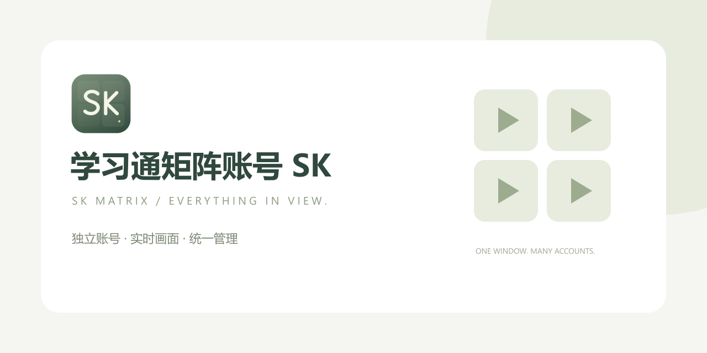
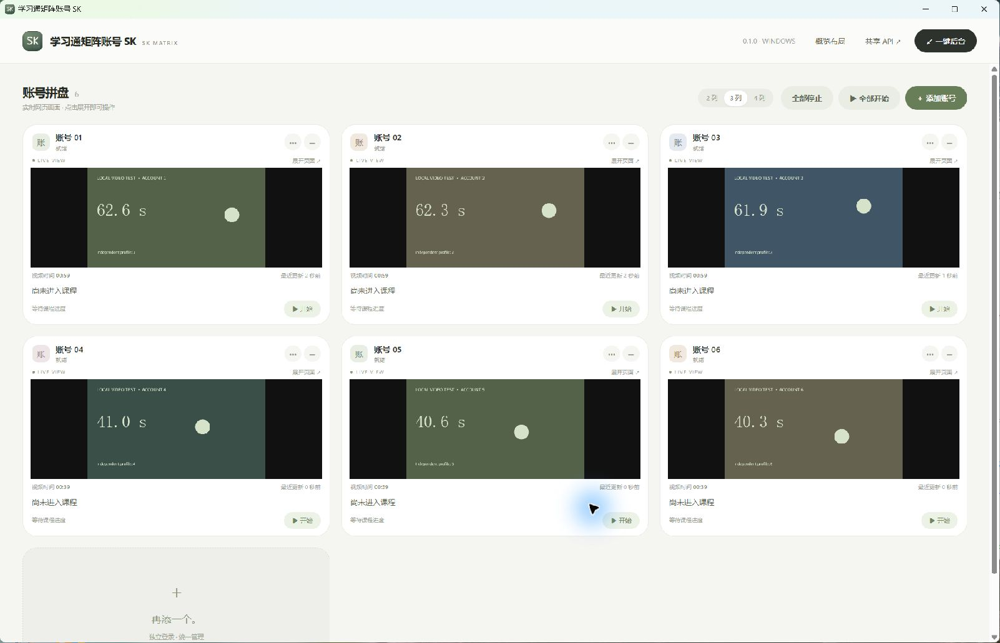

# xuexitong矩阵刷课

<p align="center">
  
</p>

<p align="center">
  <strong>一个窗口，把多个账号的画面与进度放在一起。</strong>
</p>

<p align="center">
  
  
  
  
</p>

<p align="center">
  <a href="docs/USAGE.md">开始使用</a> ·
  <a href="docs/BUILD.md">本地构建</a> ·
  <a href="CHANGELOG.md">更新记录</a> ·
  <a href="docs/RELEASE.md">发布指南</a>
</p>

## 看画面，就知道进展

**xuexitong矩阵刷课** 是一个 Windows 多账号课程工作台，桌面客户端名称为 **学习通矩阵账号 SK / SK Matrix**。
账号各自登录，画面集中展示。你可以直接看视频是否在动，展开任意
账号进行操作，再回到拼盘管理全部任务。

界面采用浅色、留白和圆角卡片；有账号时默认进入画面优先模式，
需要详细信息时切回概览。



> 预览使用本地动态视频测试素材，不展示真实账号资料或课程完成记录。

## 主要功能

| 能力 | 使用方式 |
|---|---|
| 独立账号 | 每个账号拥有单独的浏览器资料，使用 ＋ / − 管理 |
| 实时拼盘 | 2/3/4 列切换；卡片内是真实 WebView/视频 |
| 单账号展开 | 完成登录、选课和手动操作后返回拼盘 |
| 统一进度 | 分账号显示章节、任务阶段、媒体时间与确认请求 |
| 共享 API | 一个提供商/模型/密钥供全部账号使用 |
| 批量控制 | 全部开始、全部停止，或单独控制 |
| 后台运行 | 一键最小化，保留有效播放器尺寸 |
| 重启恢复 | 保留账号资料，任务恢复为停止状态 |

## 三步开始

1. 下载 Windows x64 便携版，打开程序。
2. 添加账号，展开页面，分别登录并选择课程。
3. 开始任务，返回拼盘；需要时再配置共享 API。

视频播放不需要 API。需要模型功能时，使用你自己的服务商配置。
共享请求最多同时发起 3 个实际网络请求。

更完整的操作和数据目录说明见 [使用指南](docs/USAGE.md)。

## 与基础版本的区别

SK Matrix 围绕多账号工作流重构了桌面运行方式：从单账号界面变为
**一个主窗口、多个独立 WebView、统一状态看板和共享模型请求队列**。
新增了账号生命周期、实时画面布局、批量控制和独立品牌发行流程。
实现入口与基线对照见 [功能差异](docs/DIFFERENCES.md)。

课程解析、部分自动化脚本、字体处理和命令生成等组件继承自
[uXueScript v2.2.2](https://github.com/unraous/uxuescript/tree/v2.2.2)。
本项目由 [climate-13](https://github.com/climate-13) 独立维护；
详细来源见 [NOTICE](NOTICE)。本项目不是对全部上游组件的原创重写，
也不是超星官方产品。

## 能力边界

- 账号数量没有固定槽位上限；实际并发受硬件、网络和平台限制。
- 休眠、断网、登录过期或平台验证仍可能中断任务。
- 本地媒体时间不等同于平台认可的学习时长或完成记录。
- 模型结果需自行判断；费用和额度由所选提供商决定。
- 当前自动更新关闭，不会连接上游项目的自动更新渠道。

## 开发

```powershell
pnpm install --frozen-lockfile
pnpm build
./scripts/build-windows.ps1
```

详见 [构建说明](docs/BUILD.md)。Windows CI 和草稿 Release 工作流已提供；
推送到你的仓库后，以实际运行结果为准。

## 开源

沿用 [GNU GPL-3.0](LICENSE)。保留上游来源和许可证，在此基础上
独立维护品牌、功能和版本。欢迎通过 Issue 提交移除了私人信息的反馈。
